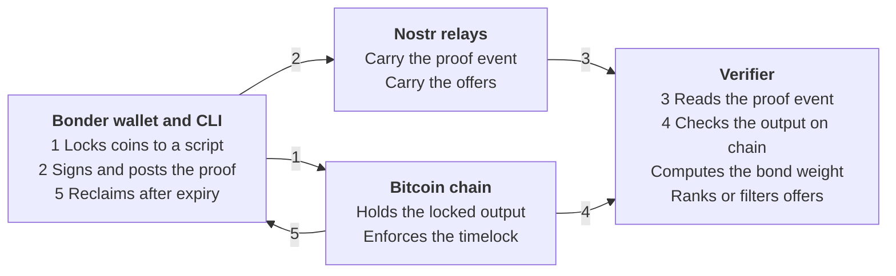
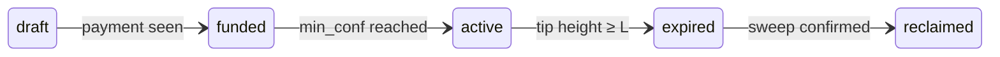

# Architecture

This document describes how the reference implementation is built. The protocol rules it implements (bond script, proof event, verification steps, weight) are in the [spec repository](https://github.com/bondpost/spec). Where the two disagree, the spec wins and this document is the one with the bug.

## How it fits together

A bond touches four parts in five steps, and no part has to trust another.



Bitcoin proves the lock, Nostr carries the claim, and the verifier joins them. The verifier is a role, not a server: it can be the library inside a client, a relay plugin, or the HTTP service. The bonder needs only the chain to get coins back at step 5.

## Components

Five components. The library and the CLI make up the whole regtest release.

| Component | What it does | Release |
| --- | --- | --- |
| `bondpost-core` | Rust library: derivation, script, proof events, verification, weight, reclaim transactions | Regtest |
| `bondpost` CLI | Wallet, bond lifecycle and verification from the terminal | Regtest |
| `bondpost-verifier` | HTTP service answering weight queries for light clients | Signet |
| Relay policy plugin | Accepts or rejects events by the author's weight | Signet |
| Reference board | Web page listing offers sorted by weight | Signet |

Suggested building blocks, all Rust crates to pin at project start: `bitcoin`, `secp256k1`, `miniscript`, `bdk_wallet`, `bitcoincore-rpc`, `esplora-client` and `nostr-sdk`.

## Library surface

```
derive_bond(base_pk, nostr_pk, locktime, network) -> Bond { bond_pk, witness_script, address }
build_proof(bond, outpoint, amount)               -> UnsignedEvent
parse_proof(event)                                -> Proof
verify(proof, chain, min_conf)                    -> Result<VerifiedBond, VerifyError>
weight(verified_bond, tip_height)                 -> u64
build_reclaim(bonds, destination, fee_rate)       -> Transaction

trait ChainSource {
    fn tip_height() -> u32
    fn utxo(outpoint) -> Option<{ script_pubkey, amount, confirmations }>
}
```

The library holds no keys and does no network I/O of its own. Signing and chain access are passed in, so the library stays testable and other clients can reuse it.

`VerifyError` has one variant per failure code in [spec 03](https://github.com/bondpost/spec/blob/main/spec/03-verification.md).

## CLI commands

| Command | Effect |
| --- | --- |
| `bondpost init --network <n>` | Create or restore the wallet seed and config |
| `bondpost bond new --npub <key> --amount <sats> --term <blocks>` | Derive the bond, run the reclaim dry run, print the address and unlock height |
| `bondpost bond fund <id>` | Pay the bond address from the built-in wallet, or wait for an outside payment |
| `bondpost bond publish <id> --relay <url>` | Build the proof event, have it signed, send it to relays |
| `bondpost bond list` | Show each bond with state, amount, blocks remaining and weight |
| `bondpost bond reclaim [<id>]` | Sweep expired bonds to the wallet |
| `bondpost bond export` / `import` | Write or read the local bond file |
| `bondpost verify <event-file or npub>` | Run verification and print the result or failure code |
| `bondpost weight <npub>` | Print the identity's total weight |

The proof event can be signed three ways:

- by a Nostr secret key in the CLI's config;
- by a remote signer over NIP-46;
- by printing the unsigned event for the user to sign elsewhere.

The last two keep the Nostr key out of the tool.

## Bond states



| State | Meaning |
| --- | --- |
| `draft` | Derived, not funded |
| `funded` | Payment seen, not yet at `min_conf` |
| `active` | Confirmed, before `L` |
| `expired` | Tip height at or past `L` |
| `reclaimed` | Sweep confirmed |

## Verifier HTTP API

| Request | Response |
| --- | --- |
| `GET /v1/weight/<nostr_pk>` | `{ "pubkey", "weight", "tip_height", "bonds": [ { "outpoint", "amount", "locktime", "weight" } ] }` |
| `GET /v1/bond/<txid>/<vout>` | One bond's verification result, or its failure code |
| `GET /v1/health` | Network, tip height, chain source in use |

The service subscribes to the bond kind on configured relays, verifies each new proof once, and caches the result until `L`. An unknown identity returns a weight of zero, not an error.

## Relay policy plugin

The first target is strfry's write-policy plugin interface: JSON over stdin and stdout, reloaded when the script changes. The plugin's configuration has three parts:

- the event kinds to guard;
- a minimum weight for each kind;
- an allowlist of exempt public keys.

Bond proof events themselves are always accepted.

## Per-network settings

These are the implementation's settings. The protocol constants are in [spec 06](https://github.com/bondpost/spec/blob/main/spec/06-networks.md).

| Setting | Regtest | Signet | Mainnet beta |
| --- | --- | --- | --- |
| Chain source | Local Bitcoin Core | Core or Esplora | Core recommended, Esplora allowed |
| Relay | Local relay | Public test relays | Public relays |
| Maximum term (overridable) | 52,560 blocks | 52,560 blocks | 52,560 blocks |
| Amount cap per bond | None | None | 1,000,000 sats (D-4) |
| Risk notice | No | No | Yes, on first use |
| Default when no `--network` is given | Yes | No | Never |

## Functional requirements

Twenty-two requirements, each traced to a business requirement in [business requirements](business-requirements.md). FR-01 to FR-14 make up the regtest release.

| ID | The system must | Traces to | Release |
| --- | --- | --- | --- |
| FR-01 | Create or restore a wallet from a BIP39 seed and store it encrypted at rest | BR-01, BR-07 | Regtest |
| FR-02 | Derive a base key, tweak and bond key exactly as in [spec 01](https://github.com/bondpost/spec/blob/main/spec/01-bond-construction.md) | BR-01, BR-02 | Regtest |
| FR-03 | Build the witness script, scriptPubKey and address for the configured network | BR-01, BR-09 | Regtest |
| FR-04 | Run a reclaim dry run before showing a funding address, and refuse on failure | BR-06, BR-08 | Regtest |
| FR-05 | Refuse a term above the maximum or an amount above the cap unless overridden by flag | BR-08 | Regtest |
| FR-06 | Show the unlock height and an estimated unlock date and require confirmation before funding | BR-08, BR-15 | Regtest |
| FR-07 | Detect funding of the bond address and track confirmations | BR-01 | Regtest |
| FR-08 | Build the proof event and sign it by local key, NIP-46 or external signing | BR-03 | Regtest |
| FR-09 | Publish the proof event to one or more relays and report each relay's answer | BR-03 | Regtest |
| FR-10 | Verify a proof by the ten steps, returning a result or one failure code | BR-04 | Regtest |
| FR-11 | Compute bond weight and identity weight by the default formula | BR-05 | Regtest |
| FR-12 | Build, sign and broadcast a reclaim transaction for one or many expired bonds | BR-06 | Regtest |
| FR-13 | Export and import a bond file, and rebuild bonds from seed plus proof events | BR-07 | Regtest |
| FR-14 | Keep wallet data, bond files and config in separate directories per network | BR-09 | Regtest |
| FR-15 | Verify through an Esplora server, with optional agreement across several servers | BR-10 | Signet |
| FR-16 | Serve the verifier HTTP API with results cached until expiry | BR-10 | Signet |
| FR-17 | Handle reorganisations by re-checking bonds confirmed in replaced blocks | BR-04 | Signet |
| FR-18 | Provide a relay plugin enforcing a minimum weight per event kind | BR-11 | Signet |
| FR-19 | Provide a web board that lists offers by descending weight and shows each bond's detail | BR-12 | Signet |
| FR-20 | Rebuild bonds from seed and public key alone by the bounded scan | BR-07 | Signet |
| FR-21 | Enforce the mainnet beta cap and show the risk notice on first mainnet use | BR-08, BR-15 | Mainnet beta |
| FR-22 | Produce reproducible release binaries with published checksums | BR-14 | Mainnet beta |

## Non-functional and security requirements

Fund safety outranks every other quality: no code path may send coins to a script the wallet cannot later spend. The threat model is in [spec 07](https://github.com/bondpost/spec/blob/main/spec/07-security-and-privacy.md).

| ID | Requirement |
| --- | --- |
| NFR-01 | Fund safety: no flag can skip the reclaim dry run (FR-04) |
| NFR-02 | Determinism: the same inputs give byte-identical scripts and addresses on every platform, proven by the spec's test vectors |
| NFR-03 | Performance: verifying one bond against a local node takes under 200 ms, and a cached lookup under 5 ms |
| NFR-04 | Secrets: the seed is encrypted at rest, never logged and never sent over the network |
| NFR-05 | Dependencies: cryptography comes only from audited crates (`secp256k1`, `bitcoin`). No hand-written curve arithmetic |
| NFR-06 | Input handling: every field of an event from a relay is treated as hostile and length-checked before use |
| NFR-07 | Availability: the CLI can reclaim with only a chain source. Coins can come back without relays or the verifier service |
| NFR-08 | Portability: Linux, macOS and Windows builds of the CLI. The library also compiles to WebAssembly for the board |
| NFR-09 | Observability: the verifier logs each verification result with its failure code, without logging IP addresses by default |
| NFR-10 | Compatibility: a version 1 verifier rejects unknown versions cleanly, so version 2 can change the script |
