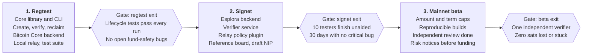

# Bondpost: bitcoin-bonded offers on Nostr

Nov 17, 2026 · @Gideon Bature

## Summary

Bondpost lets a Nostr identity prove it has bitcoin locked until a future block, so clients and relays can rank or filter its offers by a real cost. It keeps the one idea from defiads that worked, timelocked coins as spam resistance, and drops the custom peer-to-peer network. Nostr relays carry the offers and Bitcoin carries the proof.

The recommendation is to build it in three gated releases: regtest, signet, then a capped mainnet beta. Mainnet waits for an independent review, because a bug in the lock or reclaim code can freeze real coins.

This is the business requirements document. The protocol itself is specified in the [spec repository](https://github.com/bondpost/spec). How this implementation is built is in [architecture](architecture.md), and the user stories are in [user stories](user-stories.md). Bondpost is a working name.

## Problem and opportunity

Open offer boards on Nostr cost nothing to flood, because a new identity is free. Peer-to-peer order books, marketplace listings and service adverts all share this weakness. Today the defences are relay allowlists, paid relays, proof of work and web-of-trust scores, and each either centralises control or is cheap to fake at scale.

defiads showed a different defence in 2019: an advert stays visible only while bitcoin is locked to it, and the coins return when the term ends. The advertiser pays in the time value of money, to nobody. Chris Belcher had proposed the same idea for JoinMarket two months earlier as fidelity bonds, and it is now written up as draft BIP46.

defiads itself stalled because it bundled the idea with its own network, wallet and light client, all maintained by one person. Bondpost unbundles it:

| Layer | defiads (2019) | Bondpost |
| --- | --- | --- |
| Offer transport | Custom peer-to-peer network | Existing Nostr relays |
| Identity | None, per advert | Nostr public key |
| Cost proof | Coins locked per advert | Coins locked per identity |
| Chain access | Built-in light client | Bitcoin Core or an Esplora server |
| Ranking | Fixed rule in every node | Default rule, each client or relay may tune it |

**Existing work to position against**

Bondpost is not first. [OrangeCheck](https://github.com/orangecheck/oc-attest-protocol) is live on mainnet, links a Bitcoin address to a Nostr key, and already ships a strfry relay filter. The difference is what the proof commits to.

|  | JoinMarket fidelity bonds (BIP46) | OrangeCheck | Bondpost |
| --- | --- | --- | --- |
| Are coins locked? | Yes, by timelock | No, they can move at any time | Yes, by timelock |
| What is measured | Amount and time locked | Amount, and days already unspent | Amount, and blocks still locked |
| Link to identity | Signed message from the bond key | BIP-322 signed message | Committed on chain in the output's key |
| Identity system | JoinMarket makers | Nostr, GitHub, DNS, Twitter | Nostr |
| Re-checking | Once, valid until expiry | Every time, since coins may have moved | Once, valid until expiry |
| Cold storage | Yes, through a certificate | Yes, any wallet that signs messages | No in version 1 |

OrangeCheck is cheaper and safer for the user because nothing is locked. Bondpost makes the stronger claim: a forward commitment that consensus enforces, tied to one identity. That is a narrower niche than this document first assumed, and decision D-6 below follows from it.

The opportunity is a small shared standard plus a reference library that any Nostr client, relay or trading tool can adopt without changing Bitcoin or issuing a token.

## Goals, non-goals and success measures

The goal is one open, verifiable way to say "this Nostr identity has X sats locked until block N".

**Goals**

- Anyone can create a bond, publish its proof, and get every satoshi back after expiry without trusting a third party.
- Anyone can verify a proof using only the published event and a view of the Bitcoin chain.
- Clients and relays can turn verified bonds into one comparable number, the bond weight.
- The format is documented well enough for a second, independent implementation.

**Non-goals**

- No token, no new chain, no change to Bitcoin consensus.
- No custody. Bondpost software never holds another person's keys or coins.
- No slashing. A bond proves cost of capital. It does not punish bad behaviour.
- No escrow, matching or trade settlement. Those stay with the tools that display the offers.
- No bond rental market in the first three releases.
- No judgement of offer content. Moderation stays with relays and clients.

**Success measures**

These targets are proposals to adjust once real usage exists.

| Measure | Target | Checked at |
| --- | --- | --- |
| Full lifecycle (create, verify, expire, reclaim) passes in automated tests | 100% of runs | Regtest exit |
| Funds lost or stuck through software fault | 0 sats | Every release |
| Time to verify one bond against a local node | Under 200 ms | Regtest exit |
| External testers who complete the lifecycle unaided | 10 people | Signet exit |
| Independent verifier implementations or integrations | 1 | Mainnet beta exit |
| Third-party clients or relays that read bond weight | 2 | Six months after mainnet beta |

## Users and stakeholders

Five groups touch the system, and the bonder carries all the financial risk.

| Who | What they want | What they risk |
| --- | --- | --- |
| Bonder: a maker, merchant or service provider posting offers | Offers that rank above free spam | Coins frozen until expiry, lost keys, a public link between identity and coins |
| Reader: someone browsing offers | Fewer fake and throwaway offers | Over-trusting a bond as a sign of honesty |
| Client developer | A library call that returns a weight for a public key | Maintenance cost, a wrong weight shown to users |
| Relay operator | A cheap rule to reject unbonded spam | Rejecting honest users who have no spare coins |
| Verifier operator | To serve bond checks to light clients | Being trusted more than its guarantees justify |

The project owner is the sixth stakeholder: a solo builder who needs a scope that one person can finish and maintain.

## Business requirements

Fifteen requirements define the product, and the nine marked Must gate the regtest release. Each one is traced to functional requirements in [architecture](architecture.md#functional-requirements) and to stories in [user stories](user-stories.md).

| ID | Requirement | Priority | First release |
| --- | --- | --- | --- |
| BR-01 | A user can lock bitcoin to their own Nostr identity for a term they choose | Must | Regtest |
| BR-02 | One locked output can back exactly one identity, enforced on chain | Must | Regtest |
| BR-03 | A user can publish a proof of the lock as a signed Nostr event | Must | Regtest |
| BR-04 | Anyone can verify a proof without contacting the bonder | Must | Regtest |
| BR-05 | A verified bond converts to a bond weight by a published default formula | Must | Regtest |
| BR-06 | A user can reclaim the full amount, less network fee, after expiry | Must | Regtest |
| BR-07 | A bond can be rebuilt from the wallet seed plus the public proof event | Must | Regtest |
| BR-08 | The software refuses unsafe locks unless the user overrides explicitly | Must | Regtest |
| BR-09 | Every network (regtest, signet, mainnet) is isolated, so a test proof never counts on mainnet | Must | Regtest |
| BR-10 | Verification works without running a full node, through an Esplora server | Should | Signet |
| BR-11 | A relay can reject or rate-limit events from identities below a minimum weight | Should | Signet |
| BR-12 | A reader can see offers ranked by bond weight in a reference web board | Should | Signet |
| BR-13 | The format is published as a draft NIP for community review | Should | Signet |
| BR-14 | Mainnet builds are reproducible and reviewed by someone other than the author | Must for mainnet | Mainnet beta |
| BR-15 | Users are told plainly about the lock, the privacy cost and the beta limits before funding | Must for mainnet | Mainnet beta |

"Unsafe" in BR-08 means a term longer than the configured maximum, an amount above the beta cap, or a locktime the software cannot later satisfy.

## Scope by release

Three releases, each closed by a gate, and no release starts until the gate before it passes.

Real coins are at risk only after two test releases pass their gates.

Regtest proves the mechanism with worthless coins, signet proves it with strangers, and mainnet beta adds caps and outside review before real value is locked. Held for later, outside these three: a compact-filter light client, hardware wallet support, per-offer bonds and bond rental.

## Risks, assumptions and open decisions

The largest risk is frozen coins from a software fault, and the largest uncertainty is whether anyone adopts the format.

**Risks**

| Risk | Effect | Response |
| --- | --- | --- |
| Bug in key derivation or script building | Coins locked to a key nobody holds | Test vectors, property tests, a reclaim dry run before funding, caps on mainnet beta |
| User locks for too long by mistake | Coins unusable for years | Maximum term of one year by default, confirmation prompt showing the unlock date |
| Lost wallet seed | Coins unrecoverable | Standard seed backup, recovery from seed plus public proof event |
| Wealth decides ranking | Large holders dominate cheaply | Weight is one input. Clients combine it with their own trust signals |
| A bond is read as proof of honesty | Readers get scammed by a bonded identity | Plain wording in every interface: a bond shows cost, not character |
| Privacy loss | Identity is tied to an output and its history | Notice before funding, guidance to fund from coins meant to be public |
| Dishonest Esplora server | Light clients shown a spent bond as live | Allow several servers and compare, full node recommended for relays |
| No adoption | The work has no users | Ship the relay plugin and board first, approach two existing projects during signet, and state plainly how this differs from OrangeCheck |
| Legal exposure | Varies by country | Software is non-custodial. Take local legal advice before promoting a mainnet service |

**Assumptions**

- Nostr relays will carry a new addressable event kind without special support.
- Offer formats in use, such as NIP-99 listings and NIP-69 orders, stay stable enough to reference.
- One developer builds the first two releases, with outside review bought or volunteered for the third.

**Open decisions**

Each decision has its own record, with options and reasoning, in the spec repository's [`decisions/`](https://github.com/bondpost/spec/tree/main/decisions). The list below is a summary.

- [ ] D-1: Weight formula, linear in amount (proposed) or squared as JoinMarket does to discourage splitting.
- [ ] D-2: Identity commitment by key tweak (proposed) or by a hash inside the script, which suits hardware wallets that sign Miniscript (Ledger, Coldcard, Jade) better.
- [ ] D-3: Final event kind number, to be checked against the NIPs registry before signet.
- [ ] D-4: Mainnet beta cap per bond. Proposed: 1,000,000 sats.
- [ ] D-5: Licence. Decided for the spec repository: CC0-1.0. Still open for this repository. Proposed: MIT or Apache-2.0 dual, matching BDK and LDK.
- [ ] D-6: Relationship to OrangeCheck. Options: stay separate as the timelocked alternative, or publish Bondpost proofs in a form OrangeCheck verifiers can also read. Decide before the draft NIP.

- [ ] D-7: Signet pilot. Pick one relay operator or offer board and measure two things there: whether weighting cuts the low-effort listings readers see, and how many legitimate sellers a given threshold shuts out. Proposed in place of shipping the verifier service, relay plugin and board all at once.
